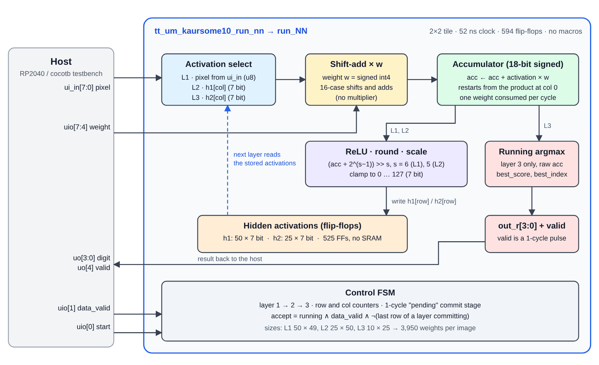
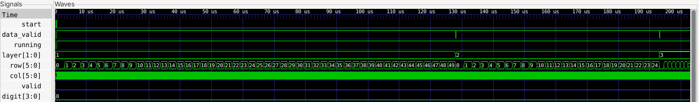
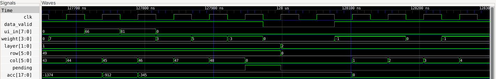
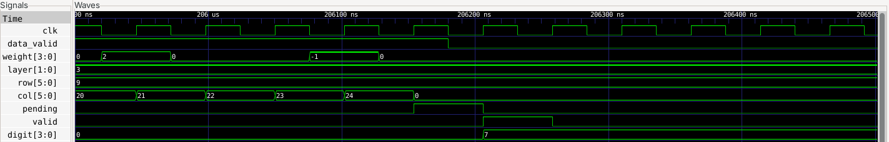
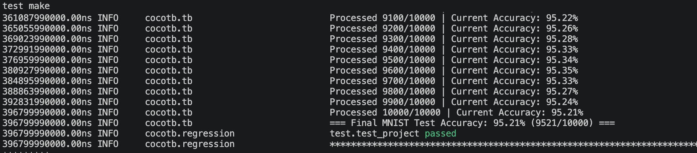
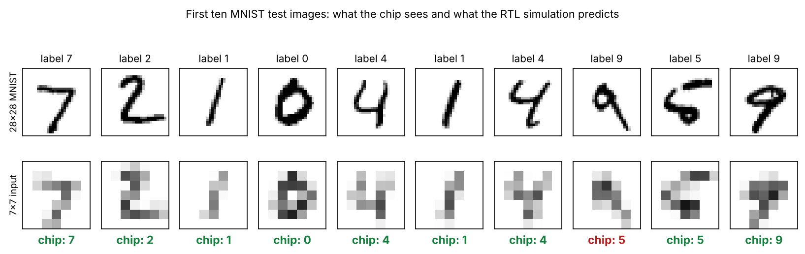

   


# MNIST Neural Network ASIC

This project is a tiny ASIC that recognises handwritten digits. It runs a quantized 3-layer neural network
(49 → 50 → 25 → 10) on a 7×7 version of an MNIST image and reports the predicted digit, 0 to 9. The network reaches
**95.21 %** accuracy on the full 10,000-image MNIST test set in RTL simulation. This repository contains the training scripts, the
SystemVerilog source, the cocotb testbench and the Tiny Tapeout configuration used to tape the design out on a **2×2 tile**
(SKY130). It started as a larger, ROM-based design (8-bit weights) and was redesigned to fit a Tiny Tapeout tile.
We acknowledge the MIT Beaver Works Summer Institute (BWSI) for their guidance and for creating this opportunity.

Project contributors: Simran Kaur, Mihir Kotamraju

## At a glance

| | |
|---|---|
| Network | 49 → 50 → 25 → 10, fully connected, ReLU, argmax |
| Input | 28×28 MNIST image average-pooled to 7×7, unsigned 8-bit pixels |
| Weights | signed 4-bit, 3,950 in total (15,800 bits), streamed in by a host |
| Compute | one shift-and-add MAC, 18-bit accumulator, one weight per clock |
| Accuracy | 95.21 % (9,521 / 10,000) on the MNIST test set |
| Latency | about 3,960 clock cycles from `start` to `valid` (about 206 µs at 19.23 MHz) |
| Tile | Tiny Tapeout 2×2 (334.88 × 225.76 µm), SKY130, top module `tt_um_kaursome10_run_nn` |
| Memory | 525 flip-flops for hidden activations, no SRAM or other macros |

## Architecture



The whole network runs on **one** multiply-accumulate unit that processes one weight per clock cycle.

- **No multiplier.** The weights are only 4 bits, so `activation × weight` is a 16-case table of shifts and adds.
- **Cheap scaling.** Layers 1 and 2 add a rounding constant, shift right by 6 and 5 (powers of two, so no multiplier), and clamp the result to 0…127.
- **Tiny memory.** Only the hidden activations are stored: `h1` is 50 × 7 bits and `h2` is 25 × 7 bits. Layer 3 keeps a running argmax, so the ten raw scores are never stored.
- **Weights come from the outside.** A weight ROM for 3,950 values would not fit a 2×2 tile, so the host streams
  the weights in, one per clock cycle, in row-major order. In layer 1 it sends the matching pixel together with each weight.
- **Small control logic.** `layer`, `row` and `col` counters plus a one-cycle "pending" stage that commits a finished
  neuron while the next one starts, so the pipeline never stalls inside a layer.

The sizes are fixed in `src/run_NN.sv`:

| Layer | Shape (neurons × inputs) | Weights | After the layer |
|---|---|---|---|
| 1 | 50 × 49 | 2,450 | ReLU, round, `>> 6`, clamp to 0…127, store in `h1` |
| 2 | 25 × 50 | 1,250 | ReLU, round, `>> 5`, clamp to 0…127, store in `h2` |
| 3 | 10 × 25 | 250 | running argmax over the raw scores |

## Interface and protocol

| Pin | Name | Direction | Meaning |
|---|---|---|---|
| `ui_in[7:0]` | pixel | in | Pixel for the current weight (layer 1 only) |
| `uio[0]` | start | in | One-cycle pulse to begin an image |
| `uio[1]` | data_valid | in | High on each cycle that carries a weight |
| `uio[7:4]` | weight | in | Signed 4-bit weight, two's complement |
| `uo[3:0]` | out | out | Predicted digit |
| `uo[4]` | valid | out | One-cycle pulse when the digit is ready |

1. Pulse `start` for one clock, with `data_valid` low.
2. Stream the 2,450 layer-1 weights with the matching pixels, then leave at least one idle cycle.
3. Stream the 1,250 layer-2 weights, then leave at least one idle cycle.
4. Stream the 250 layer-3 weights.
5. Two cycles after the last weight, `valid` pulses for one cycle and `out` holds the digit.

The full pin description, host pseudocode and data preparation are in [docs/info.md](docs/info.md).

## Simulation waveforms

These are real captures from the RTL simulation (Icarus Verilog, viewed in GTKWave) of the first MNIST test image, a 7.
The chip is reset, `start` is pulsed, and the host starts streaming weights and pixels:


The whole inference at a glance: layer 1 takes 50 rows, layer 2 takes 25 and layer 3 takes 10 (about 206 µs in total):



The transition from layer 1 to layer 2: after the last weight there is one idle cycle (`data_valid` low), the finished
row is committed (`pending`), `layer` becomes 2 and `row` returns to 0:



The end of the run: the last layer-3 weights, the commit cycle, then `valid` pulses for one cycle and `digit` shows 7:



## Repository layout

| Path | Contents |
|---|---|
| `src/project.sv` | Tiny Tapeout wrapper `tt_um_kaursome10_run_nn`: maps the pins to the network |
| `src/run_NN.sv` | The neural network: control, shift-add MAC, requantization, argmax |
| `src/weights/` | Trained int4 weights (`weights_W1/W2/W3.mem`, one hex digit per line) |
| `tools/train_quantized.py` | Quantization-aware training; exports the `.mem` weight files |
| `tools/evaluate_mnist.py` | Bit-exact Python model; reports accuracy on the 10,000 test images |
| `test/` | cocotb testbench (`test.py`, `tb.v`, `Makefile`) |
| `sim/` | Icarus Verilog protocol testbench (`tb_protocol.v`) and a few sample pooled images (`pix.mem`) |
| `docs/` | Datasheet (`info.md`) and the images used in the docs |
| `info.yaml` | Tiny Tapeout project description and pinout |

## Training and evaluating the weights

The training model mirrors the hardware: 7×7 average-pooled pixels, signed int4 weights, ReLU, rounded shifts of 6 and 5, and a 0…127 clamp.

```sh
pip install torch torchvision numpy
python tools/train_quantized.py --output-dir src/weights      # trains and writes the .mem files
python tools/evaluate_mnist.py --weights-dir src/weights      # prints accuracy on the 10,000 test images
```

## Testbench

The cocotb testbench drives the design through the Tiny Tapeout wrapper exactly as a real host would: it resets the chip, pulses `start`,
streams the weights and pixels, waits for `valid` and compares the result with the label, for every image in the MNIST test set.

```sh
cd test
make                  # RTL simulation
make -B GATES=yes     # gate-level simulation (needs the netlist from the GDS workflow)
```



The RTL result, 9,521 of 10,000 images correct, equals the Python model in `tools/evaluate_mnist.py`, and the two agree on every
single image. An independent Icarus Verilog testbench that drives only the chip pins gives the same 9,521.

How the chip sees the data: the first ten test images, their 7×7 inputs and the digit the RTL predicts (green is correct, red is wrong):



The protocol-level testbench can be run on its own:

```sh
iverilog -g2012 -o sim.vvp src/run_NN.sv src/project.sv sim/tb_protocol.v
vvp sim.vvp +PIX=sim/pix.mem +N=10 +GAP=2            # +PAUSE=30 adds random idle cycles, +VCD dumps run.vcd
gtkwave run.vcd
```

## Physical implementation

Hardened with LibreLane (OpenROAD) for SKY130 on a 2×2 Tiny Tapeout tile at a 52 ns clock (19.23 MHz). Figures from the
hardening report:

| Metric | Result |
|---|---|
| Die size | 334.88 × 225.76 µm (75,603 µm²) |
| Standard-cell area | 42,442 µm² (58.5 % core utilization) |
| Cells | 4,571 standard cells, 594 flip-flops, 0 macros |
| DRC (Magic and router) | 0 errors |
| LVS | 0 errors |
| Antenna violations | 0 |
| Setup timing | no violations in any corner; worst slack +24.4 ns (slow corner, 100 °C, 1.60 V) |
| Hold timing | no violations in any corner; worst slack +0.11 ns |
| Power (nominal, estimated) | about 2.3 mW |

The worst setup slack suggests the logic could run at a considerably higher clock than 19.23 MHz. The practical limit is the
host that streams the weights.

## Limitations

- **Not self-contained.** A host controller must stream all 3,950 weights for every inference. Layer 1 also needs the pixel repeated for every row.
- **`valid` is a single-cycle pulse.** The host must sample it every clock cycle (or step the clock). `out` keeps its value afterwards.
- **No backpressure.** The chip cannot signal when it is ready. Leave at least one idle cycle between layers.
- **Accuracy trade-off.** A 7×7 input and 4-bit weights cost accuracy compared with a full-size network. This design reaches 95.21 %.

## Resources

- [docs/info.md](docs/info.md): datasheet with pins, protocol and test instructions
- [Tiny Tapeout](https://tinytapeout.com) and its [FAQ](https://tinytapeout.com/faq/)
- [Build your design locally](https://www.tinytapeout.com/guides/local-hardening/)
- Enable [GitHub Pages](https://tinytapeout.com/faq/#my-github-action-is-failing-on-the-pages-part) so the GitHub Action can publish the results page.
