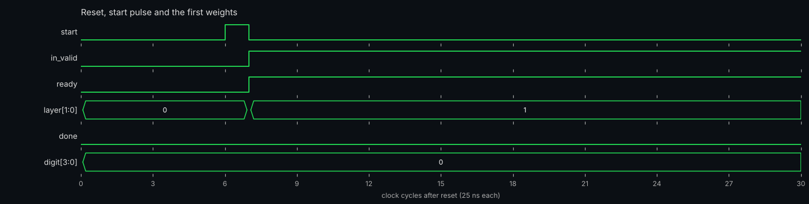
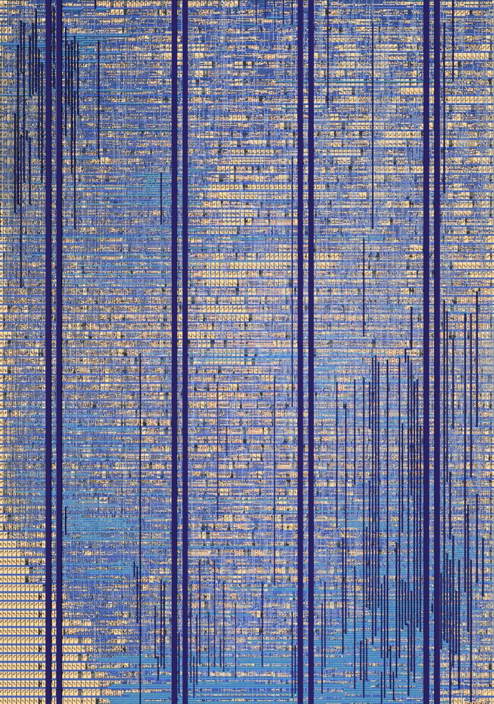
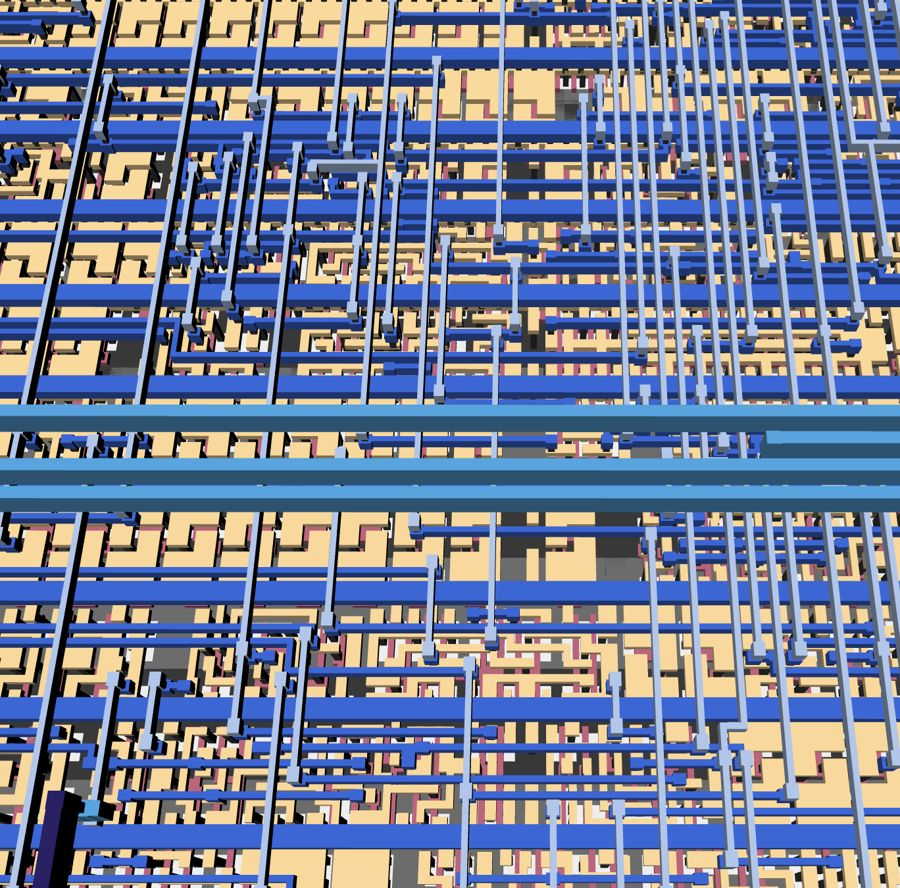

   


<p align="left">
  <br>
  <em>MITRE: Proud sponsor of Basics of ASICs</em>
</p>

# MNIST Neural Network ASIC

This project is a tiny ASIC that recognises handwritten digits. It runs a quantized 3-layer neural network
(49 → 40 → 20 → 10) on a 7×7 version of an MNIST image and reports the predicted digit, 0 to 9. The network reaches
**96.21 %** accuracy on the full 10,000-image MNIST test set in RTL simulation. This repository contains the trained weights,
the Verilog source, the cocotb testbench and the Tiny Tapeout configuration used to tape the design out on a **1×2 tile**
(SKY130). An earlier version of this project kept its weights in an on-chip ROM; this version streams 4-bit weights in so that it fits a 1×2 tile.
We acknowledge the MIT Beaver Works Summer Institute (BWSI) for their guidance and for creating this opportunity.

Project contributors: Simran Kaur, Mihir Kotamraju, Nimay Shah, Franklin Chen

## At a glance

| | |
|---|---|
| Network | 49 → 40 → 20 → 10, fully connected, ReLU, argmax |
| Input | 28×28 MNIST image average-pooled to 7×7, unsigned 8-bit pixels |
| Weights | signed 4-bit, 2,960 in total (11,840 bits), streamed in by a host |
| Compute | one shift-and-add MAC, 18-bit accumulator, one weight per clock |
| Accuracy | 96.21 % (9,621 / 10,000) on the MNIST test set |
| Latency | 2,963 clock cycles from `start` to `done` (about 74 µs at 40 MHz) |
| Tile | Tiny Tapeout 1×2, SKY130, top module `tt_um_kaursome10_run_nn` |
| Memory | 360 flip-flops for hidden activations, no SRAM or other macros |

## Architecture


The whole network runs on **one** multiply-accumulate unit that processes one weight per clock cycle.

- **No multiplier.** The weights are only 4 bits, so `activation × weight` is a 16-case table of shifts and adds.
- **Cheap scaling.** Layers 1 and 2 add a rounding constant, shift right by 7 and 4 (powers of two, so no multiplier), and clamp the result to 0…63.
- **Tiny memory.** Only the hidden activations are stored: `h1` is 40 × 6 bits and `h2` is 20 × 6 bits, held in rotating shift registers so no read multiplexer is needed. Layer 3 keeps a running argmax, so the ten raw scores are never stored.
- **Weights come from the outside.** A weight ROM for 2,960 values would not fit a 1×2 tile, so the host streams
  the weights in, one per clock cycle, in row-major order. In layer 1 it sends the matching pixel together with each weight.
- **Flow control.** The `ready` output tells the host when an element is accepted. It drops for one cycle after layer 1 and after layer 2, while the last neuron of that layer is stored.

The sizes are set by parameters in `src/nn_core.v`:

| Layer | Shape (neurons × inputs) | Weights | After the layer |
|---|---|---|---|
| 1 | 40 × 49 | 1,960 | ReLU, round, `>> 7`, clamp to 0…63, store in `h1` |
| 2 | 20 × 40 | 800 | ReLU, round, `>> 4`, clamp to 0…63, store in `h2` |
| 3 | 10 × 20 | 200 | running argmax over the raw scores |

## Interface and protocol

| Pin | Name | Direction | Meaning |
|---|---|---|---|
| `ui_in[7:0]` | pixel | in | Pixel for the current weight (layer 1 only) |
| `uio[0]` | start | in | One-cycle pulse to begin an image |
| `uio[1]` | in_valid | in | High on each cycle that carries a weight |
| `uio[7:4]` | weight | in | Signed 4-bit weight, two's complement |
| `uo[3:0]` | digit | out | Predicted digit |
| `uo[4]` | done | out | High when the digit is ready, held until the next `start` |
| `uo[5]` | ready | out | High when the chip accepts an element this cycle |
| `uo[7:6]` | layer | out | Layer being fed (1 to 3), 0 when no image is running |

1. Pulse `start` for one clock, with `in_valid` low.
2. Stream the 1,960 layer-1 weights with the matching pixels, sending only on cycles where `ready` is high.
3. Stream the 800 layer-2 weights (`ready` drops for one cycle before them).
4. Stream the 200 layer-3 weights (`ready` drops for one cycle before them).
5. `done` goes high and `digit` holds the prediction.

The full pin description, host pseudocode and data preparation are in [docs/info.md](docs/info.md).

## Simulation waveforms

These are captures from the RTL simulation (Icarus Verilog) of the first MNIST test image, a 7, driven through the chip pins at a 25 ns clock.
The chip is reset, `start` is pulsed, and the host starts streaming weights and pixels:



The whole inference at a glance: layer 1 takes 1,960 elements, layer 2 takes 800 and layer 3 takes 200 (2,963 cycles, about 74 µs in total):


The transition from layer 1 to layer 2: after the last layer-1 weight, `ready` and `in_valid` drop for one cycle while the last neuron is stored, then `layer` becomes 2:


The end of the run: the last layer-3 weights, then `done` goes high and `digit` shows 7:


## Repository layout

| Path | Contents |
|---|---|
| `src/project.v` | Tiny Tapeout wrapper `tt_um_kaursome10_run_nn`: maps the pins to the network |
| `src/nn_core.v` | The neural network: control, shift-add MAC, requantization, argmax |
| `src/weights/` | Trained int4 weights (`weights_W1/W2/W3.mem`, one hex digit per line) |
| `src/config.json` | Hardening (LibreLane) configuration |
| `test/` | cocotb testbench (`test.py`, `tb.v`, `Makefile`, `requirements.txt`), the 7×7 MNIST test set (`mnist_test_images.mem`, `mnist_test_labels.mem`) and the script that generates it (`generate.py`) |
| `sim/` | Standalone protocol testbench (`tb_protocol.v`) with a sample image (`pix.mem`) |
| `tools/` | Early training and evaluation scripts (`train_quantized.py`, `evaluate_mnist.py`) for a 49 → 50 → 25 → 10 variant with shifts of 6 and 5. They do not match the current 40 → 20 → 10 network and cannot regenerate or check the weights in `src/weights/` |
| `.github/workflows/` | CI: `gds`, `test`, `docs` and `fpga` |
| `docs/` | Datasheet (`info.md`) and the images used in the docs |
| `info.yaml` | Tiny Tapeout project description and pinout |

## Weights

The trained weights are checked in as `src/weights/weights_W1.mem`, `weights_W2.mem` and `weights_W3.mem` (signed int4, one hex digit per line, row-major: 1,960 + 800 + 200 values). They were trained with quantization-aware training that mirrors the hardware: 7×7 average-pooled pixels, signed int4 weights, ReLU, rounded shifts of 7 and 4, and a 0…63 clamp, using a straight-through estimator so the forward pass is bit-exact with the chip.

The training script that produced these exact weights is not included in this repository. The scripts in `tools/` are earlier versions for a different network size (see the layout table above).

## Testbench

The cocotb testbench drives the design through the Tiny Tapeout wrapper exactly as a real host would: it resets the chip, pulses `start`,
streams the weights and pixels, waits for `done` and compares the result with a bit-exact Python model. Its five tests are:

- `test_reference_model_ranges`: checks that no layer sum overflows the 18-bit accumulator, including for an all-255 image
- `test_images_back_to_back`: several images in a row
- `test_real_mnist_digits`: real MNIST test digits (embedded in `test.py`), 20 samples, of which the chip must classify at least 17 correctly
- `test_random_pauses`: the host pauses at random between weights
- `test_restart_mid_run`: a new `start` in the middle of an image

The same test runs on the gate-level netlist, because it only uses the top-level pins.

```sh
cd test
make                  # RTL simulation
make -B GATES=yes     # gate-level simulation (needs the netlist from the GDS workflow)
```

The checked-in weights classify 9,621 of the 10,000 MNIST test images correctly (96.21 %) when run through the same arithmetic as `reference()` in `test/test.py`, using the 7×7 inputs in `test/mnist_test_images.mem` and the labels in `test/mnist_test_labels.mem`. The full 10,000-image RTL run shown below is not part of CI.


How the chip sees the data: the first ten test images, their 7×7 inputs and the digit the RTL predicts (green is correct, red is wrong):


## Physical implementation

Hardened with LibreLane (OpenROAD) for SKY130 on a 1×2 Tiny Tapeout tile at a 25 ns clock (40 MHz).

| Metric | Result |
|---|---|
| Core utilization | 78.1 % |
| Cells (Yosys, mapped) | 993 cells, 430 flip-flops, 0 macros |
| Estimated cell area (Yosys) | 16,028 µm² |
| DRC | clean |
| LVS | clean |
| Antenna violations | none |
| Setup and hold timing | met at 25 ns |

After hardening, the layout is DRC and LVS clean. The full 1×2 tile as rendered by the Tiny Tapeout GDS viewer, and a close-up of the metal routing:





## Limitations

- **Not self-contained.** A host controller must stream all 2,960 weights for every inference. Layer 1 also needs the pixel repeated for every row.
- **The host must honour `ready`.** `ready` drops for one cycle after layers 1 and 2, and an element sent on that cycle is lost.
- **High utilization.** The 1×2 tile is about 78 % full, so there is little room for further logic.
- **Accuracy trade-off.** A 7×7 input and 4-bit weights cost accuracy compared with a full-size network. Accuracy was measured on the MNIST test set with 4×4 box-average preprocessing.

## Resources

- [docs/info.md](docs/info.md): datasheet with pins, protocol and test instructions
- [Tiny Tapeout](https://tinytapeout.com) and its [FAQ](https://tinytapeout.com/faq/)
- [Build your design locally](https://www.tinytapeout.com/guides/local-hardening/)