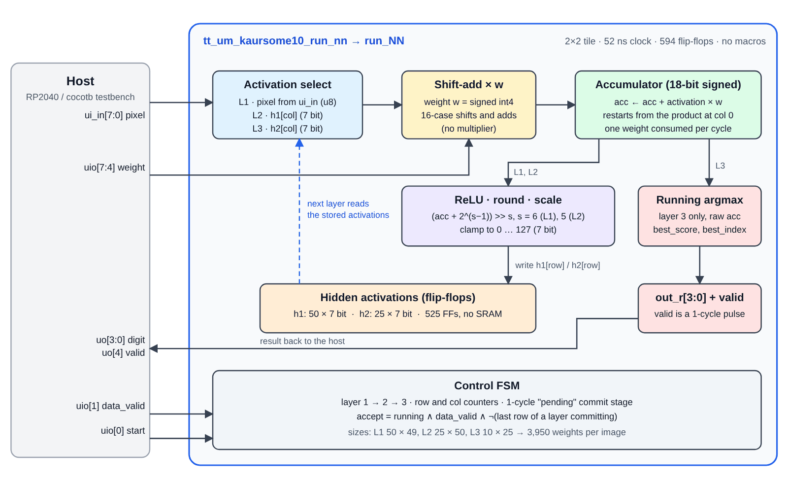
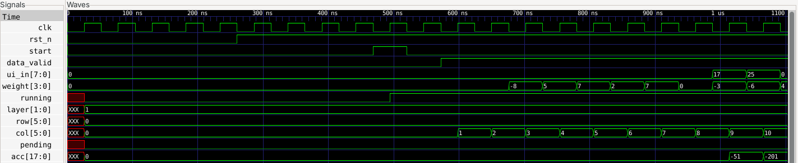
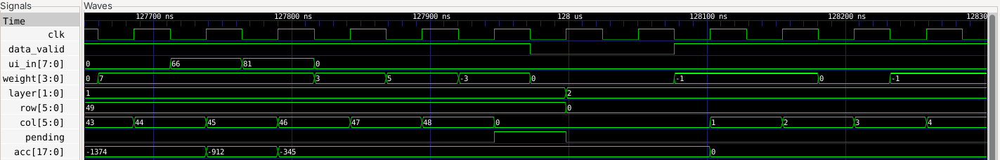
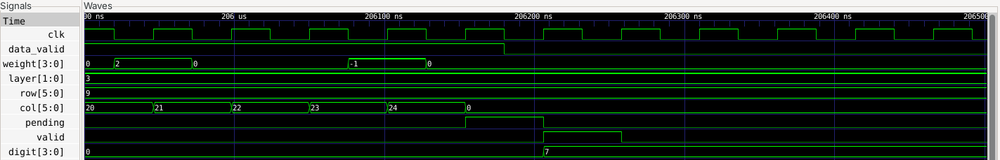
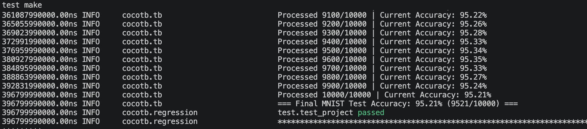

<!---

This file is used to generate your project datasheet. Please fill in the information below and delete any unused
sections.

You can also include images in this folder and reference them in the markdown. Each image must be less than
512 kb in size, and the combined size of all images must be less than 1 MB.
-->

## How it works

This project is a small neural-network inference engine that recognises handwritten digits (MNIST). It runs a
quantized 3-layer fully connected network on a 7×7 grayscale image and outputs the predicted digit, 0 to 9.

| | |
|---|---|
| Network | 49 → 50 → 25 → 10 (three fully connected layers) |
| Input | 7×7 image, unsigned 8-bit pixels (the 28×28 MNIST image average-pooled in 4×4 blocks by the host) |
| Weights | signed 4-bit (−8 … 7), 3,950 in total: 2,450 + 1,250 + 250 |
| Activations | 7-bit unsigned after ReLU, rounding and scaling |
| Accuracy | **95.21 %** (9,521 / 10,000) on the full MNIST test set, measured in RTL simulation (Icarus Verilog and cocotb) |
| Clock | 19.23 MHz (52 ns period) |



**One MAC for the whole network.** All three layers share a single multiply-accumulate unit that handles one weight
per clock cycle. The multiplier is replaced by a 16-case shift-and-add table, because the weight is only a signed
4-bit number. The sum is kept in an 18-bit accumulator.

**Weights are streamed in, not stored.** The chip has no weight memory. The host sends every weight, in row-major
order, one per clock cycle. Layer 1 also needs the matching pixel on `ui_in` for each weight, so each of the 49
pixels is sent once per layer-1 neuron. In layers 2 and 3 the activations come from the chip's own registers
and `ui_in` is ignored.

**Layer by layer.**

1. **Layer 1:** 50 neurons × 49 inputs. After each neuron's 49 weights the result goes through ReLU, adds a
   rounding constant, shifts right by 6 and clamps to 0…127. The 7-bit value is stored in `h1[0..49]`.
2. **Layer 2:** 25 neurons × 50 inputs, read from `h1`. Same ReLU, rounding and clamp, with a shift of 5. Stored in `h2[0..24]`.
3. **Layer 3:** 10 neurons × 25 inputs, read from `h2`. No ReLU or scaling. A running argmax keeps the best score and its
   index. The first maximum wins on ties.

`h1` and `h2` are ordinary flip-flop arrays (525 flip-flops). The design uses no SRAM or other macros.
The last row of each layer is committed by a one-cycle "pending" stage, so the host has to leave one idle cycle
between layers (see below). The other rows commit while the next row's first weight is being accepted, with no stall.

## How to test

### Pins

| Pin | Name | Direction | Meaning |
|---|---|---|---|
| `ui_in[7:0]` | pixel | in | Pixel for the current weight (0…255). Used in layer 1 only. |
| `uio[0]` | start | in | Pulse high for one clock to begin an image. Ignored while an image is running. |
| `uio[1]` | data_valid | in | High on every cycle that carries a weight. Cycles with it low are ignored, so the host may also pause between weights. |
| `uio[7:4]` | weight[3:0] | in | Signed 4-bit weight, two's complement, `uio[4]` is bit 0. |
| `uio[2]`, `uio[3]` | reserved | in | Unused. |
| `uo[3:0]` | out | out | Predicted digit, valid once `valid` has pulsed. It holds until the next image finishes. |
| `uo[4]` | valid | out | Goes high for **one clock cycle**, two cycles after the cycle that carries the last weight. |
| `uo[7:5]` | – | out | Always 0. |

`rst_n` is asynchronous and active low. All `uio` pins are inputs (`uio_oe = 0`).

### Sequence for one image

The waveforms below are real simulation output (Icarus Verilog, viewed in GTKWave) for the first MNIST test image, a 7.



1. Reset the chip (`rst_n` low for a few cycles, then high).
2. Pulse `start` for one clock cycle, with `data_valid` low.
3. **Layer 1:** for `r` in 0…49 and `c` in 0…48, drive `ui_in = pixel[c]` and `weight = W1[r][c]` with `data_valid = 1`
   for one clock cycle. This is 2,450 cycles.
4. Drive `data_valid` low for **at least 1 idle cycle** (the testbench uses 2). A weight sent on that cycle is dropped,
   and with no idle cycle at all the image never completes.
5. **Layer 2:** stream `W2[r][c]` for `r` in 0…24 and `c` in 0…49 (1,250 cycles). `ui_in` is ignored.
6. Idle for at least 1 cycle again.
7. **Layer 3:** stream `W3[r][c]` for `r` in 0…9 and `c` in 0…24 (250 cycles).
8. Wait for `uo[4]` (valid) to pulse, then read `uo[3:0]`. A full image takes about 3,960 clock cycles
   from `start` to `valid` (about 206 µs at 19.23 MHz).

The layer 1 → layer 2 transition. The last weight of layer 1 is column 48 of row 49. The following cycle is the
one-cycle commit (`pending`), after which `layer` becomes 2 and `row` returns to 0:



The end of the run. `valid` pulses for one cycle and `digit` shows 7:




Pseudocode for the host:

```python
def classify(pixels, W1, W2, W3):      # pixels: 49 ints 0..255, W*: flat row-major lists of ints -8..7
    pulse_start()                       # uio[0] high for one clock, data_valid low
    for r in range(50):
        for c in range(49):
            clock(ui_in=pixels[c], weight=W1[r * 49 + c] & 0xF, data_valid=1)
    clock(data_valid=0); clock(data_valid=0)
    for w in W2:                        # 25 x 50
        clock(weight=w & 0xF, data_valid=1)
    clock(data_valid=0); clock(data_valid=0)
    for w in W3:                        # 10 x 25
        clock(weight=w & 0xF, data_valid=1)
    clock(data_valid=0)
    while not valid_seen():             # valid is a 1-cycle pulse: sample it every clock
        clock(data_valid=0)
    return read_uo(3, 0)
```

### Preparing the data

- **Weights:** the files `src/weights/weights_W1.mem`, `weights_W2.mem` and `weights_W3.mem` hold one weight per
  line as a single hex digit. It is a 4-bit two's complement value in row-major order (W1 is 50 × 49, W2 is 25 × 50,
  W3 is 10 × 25). A `.mem` digit can be sent as it is.
- **Pixels:** average-pool the 28×28 MNIST image in non-overlapping 4×4 blocks, round to the nearest integer,
  and flatten the result row by row into 49 values.
  `tools/evaluate_mnist.py` does exactly this.

### Simulation

The cocotb testbench in `test/` streams the weights and every MNIST test image through the Tiny Tapeout wrapper and
reports the running accuracy (95.21 % over 10,000 images). Run it with `cd test && make`.
The result matches the Python reference model in `tools/evaluate_mnist.py` image for image.



A second, protocol-level Icarus Verilog testbench (`sim/tb_protocol.v`) drives only the chip's pins and also checks the
timing claims above: `valid` is a one-cycle pulse, `out` holds its value afterwards, a gap of one or two idle cycles works
and random idle cycles inside a layer are harmless.

## External hardware

The chip does not store its weights, so a **host controller must stream them in on every inference**.
On the Tiny Tapeout demo board this can be the on-board RP2040, which also provides the clock. The
host needs to hold the 3,950 weights (about 2 KB when packed as nibbles) and, for each image, the 49 pooled pixel values.

Nothing else is needed. All inputs and outputs are plain digital signals, and the result can be read from `uo[3:0]` or
shown on LEDs.

The chip is designed for a 19.23 MHz clock, but the host that feeds the weights sets the practical speed.
A host that cannot sustain one weight per clock can drive a slower clock, or step the clock once per weight.
